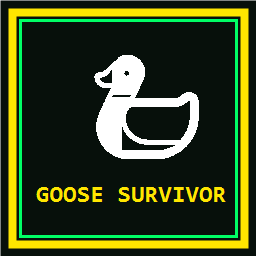

# 🦆 Goose Survivor: Bullet Hell 💥

<div align="center">



### *"Peace Was Never An Option."*

A fast-paced **Bullet Hell Roguelite Web Game** where you control a feisty Goose with **WASD**, dodge dense bullet curtains, unleash sonic **HONK!** shockwaves, lay explosive golden egg mines, and draft overpowered roguelite upgrades!

[](https://thagoose3.github.io/goose-survivor/)
[](#)
[](#)
[](#)

</div>

---

## 🌟 Key Features

- 🕹️ **WASD 8-Directional Movement & Dash Roll**: Smooth goose waddling physics, wing-flapping animations, and **Spacebar / Shift** dash with invulnerability frames (i-frames).
- 📢 **Mega HONK! Sonic Deflector (`H` / Left Click)**: Unleashes an expanding acoustic shockwave that vaporizes incoming enemy bullets and knocks monsters back.
- 🎯 **Touhou-Style Core Hitbox**: Features a tight glowing Cyan Core Hitbox inside the goose. Grazing bullets awards extra **GRAZE EXP bonuses**.
- 🍞 **Health Bread Drops & 🧛 Vampiric Life Steal**: Slain monsters drop bread loaves (+25 HP). Upgrade to **Vampiric Goose Fangs** to siphon health on every single kill!
- 🎁 **8 Special Field Power-Ups & Lucky Crates**:
  - 🍞 *Juicy Bread Loaf* (+25 HP Heal)
  - 🧲 *Golden Vacuum Magnet* (Instantly sucks all Corn Gems across the arena)
  - ⏱️ *Chrono Pocket Watch* (Freezes time for 4.0 seconds)
  - 💣 *Golden Mega Egg Nuke* (Wipes the entire screen of bullets & normal enemies)
  - ☕ *Espresso Hyper Boost* (2x Speed & 3x Feather Gatling for 6.0 seconds)
  - 🛡️ *Divine Bubble Shield* (Absorbs 3 hits)
  - 🌶️ *Spicy Flaming Goose* (Leaves scorch trails and burns enemies on contact)
  - 🎁 *Lucky Mystery Crates* (Drops multiple power-ups and huge corn loot)
- 🪶 **Rich Roguelite Upgrades**:
  - 🪶 *Feather Gatling* (Auto-fires rapid razor feathers)
  - 🥚 *Golden Egg Mines* (Lays ticking explosive eggs as you run)
  - 🔪 *Peace Was Never An Option* (Equips spinning Butter Knives)
  - 💨 *Goose Zoomies* (Movement speed & Dash cooldown reduction)
- 🌀 **Bullet Hell Enemy Waves & Boss Battles**:
  - *Angry Farmers* (3-way pitchfork spreads)
  - *Cyber Drones* (Aimed energy bolts)
  - *Cyber Foxes* (5-way shotgun spreads)
  - *Combine Harvester Boss* (Giant 360-degree rotating bullet spirals)
- 🔊 **Procedural Web Audio API Synthesizer**: Authentic synthesized goose trumpet honks, waddle footsteps, egg explosions, and level-up chimes (100% offline, zero external mp3s).
- 🎨 **v2 Visual Overhaul**: Hand-drawn farmer, drone, fox and Combine Harvester sprites, glowing additive bullets, hit-flash, shockwaves, dash afterimages, night-field backdrop, boss HP bar & banners.
- 📱 **Mobile Ready**: Virtual joystick, touch HONK/DASH buttons, responsive HUD & menus, HiDPI rendering, haptics, pause, best-time save.
- ❄️ **Ultra-Optimized Silent Fan Engine**: Zero costly canvas blurs, pre-rendered background cache, and throttled HUD reflows for cold & quiet laptops.

---

## 🎮 Controls

| Key | Action |
|:---:|:---|
| <kbd>W</kbd> <kbd>A</kbd> <kbd>S</kbd> <kbd>D</kbd> / Arrow Keys | Move Goose in 8 directions |
| <kbd>Space</kbd> / <kbd>Shift</kbd> | ⚡ **Dash Roll** with invulnerability frames |
| <kbd>H</kbd> / **Left Click** | 📢 **HONK!** (Vaporize bullets & knockback) |
| <kbd>1</kbd> / <kbd>2</kbd> / <kbd>3</kbd> | Select Upgrade Card during Level-Up |
| <kbd>F11</kbd> | Toggle Borderless Fullscreen |
| <kbd>Esc</kbd> / <kbd>P</kbd> | Pause / Resume |

### 📱 Mobile / Touch

| Touch | Action |
|:---:|:---|
| Drag anywhere (left side) | Floating virtual joystick, analog movement |
| **⚡ DASH** button | Dash roll with i-frames |
| **📢 HONK** button | HONK shockwave (cooldown ring shows when it's ready) |
| Tap a card | Pick an upgrade on level-up |
| **❚❚** | Pause (also auto-pauses when you switch apps) |

Works in portrait and landscape (landscape recommended). On phones the camera zooms out so you see more of the arena. Use *Add to Home Screen* for fullscreen play.

---

## 🚀 How to Run Locally

1. Clone or download this repository:
   ```bash
   git clone https://github.com/Thagoose3/goose-survivor.git
   ```
2. Open `index.html` directly in any modern browser (Chrome, Edge, Firefox, Safari).
3. No build tools, Node.js, or server installation required!

---

## 📜 License

Distributed under the **MIT License**. See `LICENSE` for more information.

<div align="center">
  <sub>Created with 🦆 and ⚡ by <a href="https://github.com/Thagoose3">Thagoose3</a></sub>
</div>

---

---

---

---

## ☕ สนับสนุนผู้พัฒนา (Buy Me a Coffee)

หากคุณชื่นชอบและเห็นว่า **Goose Survivor** มอบความสนุกและความมันส์ให้กับคุณ สามารถร่วมสนับสนุนค่ากาแฟและเป็นกำลังใจในการพัฒนาฟีเจอร์ใหม่ๆ ได้ที่ QR Code ด้านล่างนี้เลยครับ 💖

<div align="center">
  <br />
  
  <br />
  <p style="margin-top: 10px; font-size: 15px; color: #334155;">
    <strong>พร้อมเพย์ (PromptPay) : นายฐากูร เอ็นสาร</strong>
  </p>
  <br />
</div>

---

<div align="center">
  <p style="font-size: 12px; color: #94a3b8;">Goose Survivor — Built with ❤️ for intense roguelite fun.</p>
</div>
